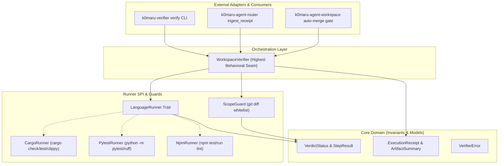

# CONTEXT.md — k0maru-verifier Domain Terminology & System Context

This document establishes the ubiquitous language, architectural seams, and domain invariants for `k0maru-verifier` to eliminate communication ambiguity between human engineers and AI agents.

---

## 🏛️ 1. System Vision & Scope

- **Core Vision**: As the 4th modular building block in **K0maru-Harness**, provide a deterministic test oracle and verification engine. Enforces "Don't trust agent promises, verify physical OS process exit codes". Before code reaches `code-review`, physically intercepts failing tests, compiler errors, linter violations, and unauthorized file edits. Issues immutable, SHA-256 signed `agent-receipt-v1.json` execution receipts for `k0maru-agent-router` and downstream verification.
- **Value Proposition**: Completely eliminates AI hallucinated green tests and silent scope creep. Provides a lightweight, fast, zero-token physical verification filter before expensive LLM reviews.

---

## 📖 2. Domain Vocabulary

| Term | Symbol / Type | Authoritative Definition | Anti-Patterns & Common Misconceptions |
| :--- | :--- | :--- | :--- |
| **Execution Receipt** | `ExecutionReceipt` | Top-level immutable signed receipt containing task ID, workspace, verdict status, step checks, and artifact hashes (`agent-receipt-v1.json`). | Never forge or modify timestamps or hashes after execution. |
| **Verdict Status** | `VerdictStatus` | Tristate final judgment: `Success` (all checks green), `Failed` (one or more checks failed), or `Blocked` (environment or execution error). | Not a boolean string; serialized as `snake_case`. |
| **Step Result** | `StepResult` / `TestStepResult` | Granular physical execution outcome of a single stage (compilation, tests, linter), recording exit code, duration, and stderr. | Never fabricate dummy counts or suppress nonzero exit codes. |
| **Scope Guard** | `ScopeGuard` | Security boundary comparing uncommitted and committed git changes against declared `allowed_files` whitelist. | Cannot be bypassed by agent discretion; failure halts promotion. |
| **Runner SPI** | `LanguageRunner` trait | Pluggable interface for language-specific build tools (`CargoRunner`, `PytestRunner`, `NpmRunner`) detecting workspace type and running checks. | Don't hardcode language commands inside core coordinator logic. |
| **Verifier Coordinator** | `WorkspaceVerifier` | Facade orchestrating runner detection, pipeline execution, scope verification, and receipt generation. | Avoid monolithic CLI scripts without reusable library facades. |

---

## 🛡️ 3. Architecture Seams & Invariants

- **Domain Invariants**:
  1. **Physical Ground Truth**: Ground truth is established solely by OS process exit codes (`exit_code == 0`) and git status.
  2. **Receipt Immutability**: Diff SHA-256 fingerprint covers all worktree modifications (`git diff HEAD`).
  3. **Strict Whitelist**: Any file modified outside the whitelist triggers `VerdictStatus::Failed` with `unauthorized_files` listed.
- **Highest Testing Seam**:
  - `WorkspaceVerifier::verify(&config)` and the CLI binary `k0maru-verifier verify`.

---

## 📚 4. Reference Pointers

- Technical Specifications: [`PROJECT.md`](PROJECT.md)
- Agent Workflow Constitution: [`AGENTS.md`](AGENTS.md)
- Receipt Specification: `docs/schemas/agent-receipt-v1.json`
