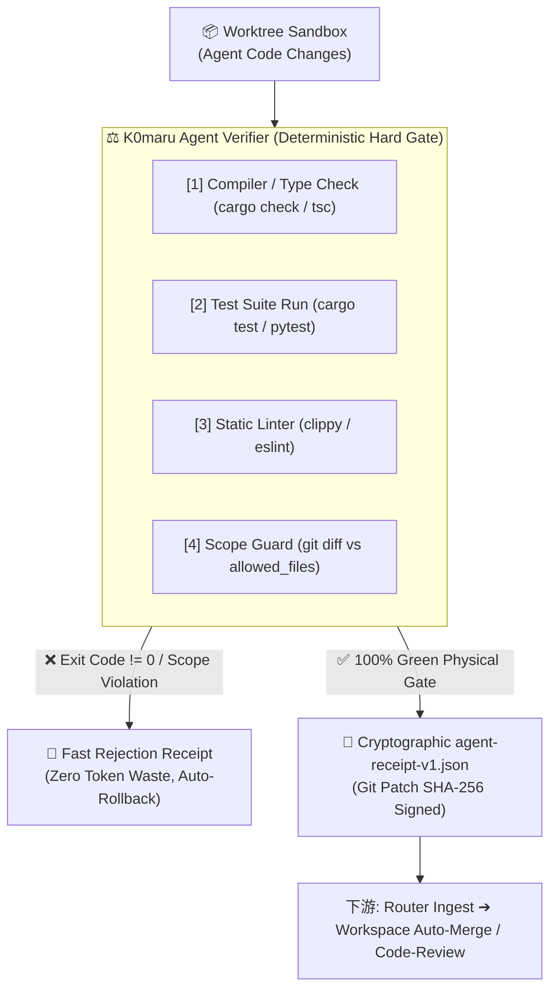

# K0maru Agent Verifier ⚖️

[English](README.md) | [简体中文](README_CN.md)

> **Deterministic Test Oracle, Scope Guard & Cryptographic Execution Receipt Signer for AI Agents**  
> The 4th modular cornerstone of the **K0maru-Harness** matrix (alongside `k0maru-agent-memory`, `k0maru-agent-router`, and `k0maru-agent-workspace`).

---

## 🎯 Overview

In autonomous multi-agent coding harnesses, verbal claims from LLMs ("I fixed the bug and all tests passed!") are fundamentally untrustworthy without physical verification. 

**K0maru Agent Verifier** provides an objective, zero-hallucination, deterministic test oracle and execution gatekeeper:
1. **Physical Facts Only**: Intercepts real process exit codes (`cargo test`, `pytest`, `npm test` == 0), compiler errors, and linter warnings.
2. **Anti-Corruption Scope Guard**: Strictly enforces modification boundaries against an authorized whitelist (`allowed_files`), rejecting out-of-scope tampering or rogue edits.
3. **Signed Execution Receipt**: Computes cryptographic SHA-256 fingerprints of git patches and outputs tamper-evident `agent-receipt-v1.json` receipts.
4. **Double-Gate Architecture**: Acts as the deterministic **Hard Physical Gate** before passing code to soft semantic audit (`code-review` / `tuicr`), eliminating 90%+ wasted review tokens.



---

## ✨ Key Features

- ⚡ **Pluggable Multi-Language Runner SPI**: Automatic detection and execution for:
  - **Rust**: `cargo check`, `cargo test`, `cargo clippy --all-targets -- -D warnings`
  - **Python**: `python -m pytest` with structured failure summary
  - **Node.js**: `npm test` / `npm run lint`
- 🛡️ **Scope Guard & Boundary Defense**:
  - Matches modified and newly created files against task-level whitelists (supports exact paths, directory prefixes, and glob wildcards like `src/**`, `tests/*`).
  - Distinguishes untracked files vs staged/unstaged changes via `git status --porcelain`.
- 🔐 **Cryptographic Receipt Protocol (`agent-receipt-v1.json`)**:
  - Signs every verification step (`compilation`, `tests`, `linter`, `scope_guard`).
  - SHA-256 digest of `git diff` patch ensures downstream consumers can verify the exact code state that was tested.
- 🚀 **Zero-Overhead CLI & Library**:
  - Clean Unix-style exit codes: `0` (Success), `1` (Verification Failed), `2` (Fatal Execution Error).
  - Human-friendly CLI output or machine-parsable `--json` stream.

---

## 🚀 Quick Start (CLI)

### 1. Build and Install

```bash
cargo build --release
# Binary available at target/release/k0maru-verifier
```

### 2. Verify a Workspace In-Place

```bash
# Verify current workspace with auto-detected runner
k0maru-verifier verify --workspace . --task-id task_auth_01

# Output signed receipt to JSON file with file whitelist
k0maru-verifier verify \
  --workspace /path/to/sandbox \
  --task-id task_auth_01 \
  --whitelist "src/auth.rs,tests/auth_test.rs" \
  --out /path/to/receipt.json \
  --json
```

### 3. Verify Using a Declarative Spec File

```bash
k0maru-verifier verify --spec task_spec.json --json
```

Example `task_spec.json`:
```json
{
  "task_id": "task_demo_01",
  "workspace": "./my-project",
  "runner": "cargo",
  "whitelist": ["src/**", "tests/**"]
}
```

---

## 📜 Execution Receipt Contract (`agent-receipt-v1.json`)

```json
{
  "$schema": "https://k0maru.dev/schemas/agent-receipt-v1.json",
  "task_id": "task_demo_01",
  "workspace": "/Users/k0maru3/workspace/my-project",
  "verdict": "success",
  "checks": {
    "compilation": {
      "status": "passed",
      "exit_code": 0
    },
    "tests": {
      "status": "passed",
      "total": 42,
      "failed": 0,
      "duration_ms": 320
    },
    "linter": {
      "status": "passed",
      "warnings": 0,
      "exit_code": 0
    },
    "scope_guard": {
      "status": "passed",
      "modified_files": ["src/lib.rs", "tests/lib_test.rs"],
      "unauthorized_files": []
    }
  },
  "artifacts": {
    "git_patch_sha256": "e3b0c44298fc1c149afbf4c8996fb92427ae41e4649b934ca495991b7852b855",
    "receipt_timestamp": "2026-10-12T16:00:00Z"
  }
}
```

---

## 🧪 Testing & Verification

```bash
# Run comprehensive test suite (Unit & Integration tests)
cargo test

# Run linter checks
cargo clippy --all-targets -- -D warnings

# Check code formatting
cargo fmt --check
```

---

## 📄 License

MIT © K0maru
